# MeditateIt

Local-first generative meditation soundscapes — noise beds, named tones (Hz), binaural/isochronic beats, and nature layers you shape in the browser. Vite + React + TypeScript, installable as a PWA.

**Live:** [https://marcfs31.github.io/MeditateIt/](https://marcfs31.github.io/MeditateIt/)

Not a medical device. Copy stays in listening / wellness language (softened labels, no treatment claims).

## Features

- **Generative audio engine** — layered noise (white / pink / brown), tone (named Hz / Solfeggio ids), beat (binaural or isochronic), nature (rain / forest / shore / wind), per-layer EQ, fades, ~2s crossfade when switching while playing
- **~50 categorized system presets** — browse chips: focus, sleep, calm, nature, beats, tones (clone any into a local user preset)
- **Sequences** — multi-stage system paths with auto-advance + crossfade; pause freezes the stage timer
- **Themes** — light, dark, dusk, mist, forest, or follow system (`prefers-color-scheme`); theme-color updates with the chrome
- **5 locales** — English, Español, Català, Français, Português (endonym picker in the header)
- **Header chrome** — language flag, theme control, and settings gear on every route
- **PWA / install** — `vite-plugin-pwa` (prompted update + discreet install affordance), offline app shell, self-hosted OFL fonts, AudioWorklet noise processor precached
- **Local-only data** — prefs, user presets, sequences, and session history in `localStorage`; JSON backup export/import (merge or replace); retention + erase-all
- **Privacy / terms stubs** — wellness disclaimer footer; no accounts, no trackers, CSP that stays checkable
- **GitHub Pages** — public site at `marcfs31.github.io/MeditateIt`. The Pages workflow lints, tests, and builds on `ubuntu-latest`, then deploys. Project path is `/MeditateIt/` (`PAGES_BASE`)

## Architecture

### Generated overview (GitDiagram)

Interactive diagram: [gitdiagram.com/marcfs31/meditateit](https://gitdiagram.com/marcfs31/meditateit)  
(Generated by [GitDiagram](https://gitdiagram.com/) — replace `hub` with `diagram` in the GitHub URL. AI overview; verify details against the source.)

```mermaid
%% Generated by https://gitdiagram.com/marcfs31/meditateit
flowchart TD

subgraph group_web["Web experience"]
  node_app["App shell + routes<br/>[App.tsx]"]
  node_home["Home<br/>[HomePage.tsx]"]
  node_session["Session player<br/>[SessionPage.tsx]"]
  node_sequence["Sequence player<br/>[SequencePage.tsx]"]
  node_settings["Settings / backup<br/>[SettingsPage.tsx]"]
  node_header["Header chrome<br/>[LanguagePicker / ThemePicker]"]
  node_pwa["PWA chrome<br/>[PwaChrome.tsx]"]
  node_legal["Privacy + Terms<br/>[PrivacyPage / TermsPage]"]
end

subgraph group_i18n_theme["Locale and theme"]
  node_i18n["i18n catalogs<br/>[i18n/*.ts]"]
  node_theme["Themes<br/>[theme/*]"]
end

subgraph group_catalog["Presets and sequences"]
  node_presets["System presets<br/>[presets/system.ts]"]
  node_categories["Categories<br/>[presets/categories.ts]"]
  node_sequences["System sequences<br/>[sequences/system.ts]"]
end

subgraph group_audio["Audio engine"]
  node_engine["AudioEngine<br/>[audio/AudioEngine.ts]"]
  node_noise["NoiseLayer + worklet<br/>[NoiseLayer / noiseWorklet]"]
  node_tone["ToneLayer<br/>[ToneLayer.ts]"]
  node_beat["BeatLayer<br/>[BeatLayer.ts]"]
  node_nature["NatureLayer<br/>[NatureLayer.ts]"]
  node_crossfade["Crossfade + Media Session<br/>[crossfade / mediaSession]"]
end

subgraph group_storage["Local storage"]
  node_prefs["Prefs<br/>[storage/prefs.ts]"]
  node_userpresets["User presets / sequences<br/>[userPresets / userSequences]"]
  node_history["Session history<br/>[sessionHistory.ts]"]
  node_backup["Backup import/export<br/>[backup.ts]"]
  node_ls[("localStorage")]
end

subgraph group_build["Build and host"]
  node_vite["Vite + PWA plugin<br/>[vite.config.ts]"]
  node_pages["GitHub Pages<br/>[.github/workflows/pages.yml]"]
end

node_listener(("Listener"))

node_listener -->|"opens app"| node_app
node_app --> node_header
node_app --> node_home
node_app --> node_session
node_app --> node_sequence
node_app --> node_settings
node_app --> node_pwa
node_app --> node_legal
node_header --> node_i18n
node_header --> node_theme
node_home --> node_presets
node_home --> node_categories
node_home --> node_sequences
node_session --> node_engine
node_sequence --> node_engine
node_engine --> node_noise
node_engine --> node_tone
node_engine --> node_beat
node_engine --> node_nature
node_engine --> node_crossfade
node_settings --> node_backup
node_prefs --> node_theme
node_prefs --> node_ls
node_userpresets --> node_ls
node_history --> node_ls
node_backup --> node_ls
node_vite -->|"PAGES_BASE=/MeditateIt/"| node_pages
```

<!-- Generated by https://gitdiagram.com/marcfs31/meditateit -->


## Run

```bash
npm install
npm run dev
```

Open the URL Vite prints (usually `http://localhost:5173`).

```bash
npm run build    # typecheck + production build
npm run preview  # serve the production build (needed to verify the service worker)
npm run lint     # oxlint
npm test         # pure *.check.ts harness (storage, recipe/EQ, i18n, CSP smoke)
```

`npm test` runs every `*.check.ts` via `tsx`. Covers backup parse/normalize, erase-all + retention purge, crossfade/EQ clamps, softened i18n copy (no medical claims), and CSP asserts on `index.html` / `public/_headers` (and `dist/index.html` when a build is present). No browser or Playwright.

## App routes

| Path | Purpose |
|------|---------|
| `/` | Home — quick start, custom, system sequences, categorized system + saved user presets, recent sessions |
| `/session`, `/session/:presetId` | Live session player (save preset from the session header) |
| `/sequence/:sequenceId` | Multi-stage sequence player |
| `/settings` | Export/import JSON backup (merge or replace), retention, erase-all, history |
| `/privacy`, `/terms` | Local-first privacy stub + wellness / non-medical terms |

## PWA

Production builds register a service worker via `vite-plugin-pwa` (`registerType: 'prompt'`). The SW precaches the app shell (HTML/JS/CSS/icons/manifest), self-hosted OFL fonts under `public/fonts/`, and `public/worklets/noise-processor.js`. No third-party font or analytics CDNs.

**Install:** a header Install control (near language / theme / settings) uses Chromium `beforeinstallprompt`, or iOS Safari Add to Home Screen guidance. The control hides when the app is already running as an installed PWA (`display-mode: standalone` / iOS `navigator.standalone`).

**Smart auto-update:** when a waiting service worker is ready, the client applies it after a short quiet window on idle / navigation / visibility return. It never activates during active generative audio — updates defer until pause/stop settles. No reload nag modal when activation is safe.

To verify installability locally:

1. `npm run build && npm run preview`
2. Open the preview URL over `http://localhost…` (Chromium treats localhost as a secure context)
3. DevTools → Application → Manifest / Service Workers
4. Header Install control, or Chrome/Edge address bar → Install app

### Offline shell

1. Load the preview URL once while online (SW install + precache)
2. DevTools → Application → Service Workers → Offline (or Network → Offline)
3. Hard-reload — `/` and client routes should still render (`navigateFallback: /index.html`)
4. Start a noise/nature session — audio is generative (no media downloads); worklet JS must come from the precache

Name: **MeditateIt**. Icons live in `public/icons/` (192 / 512).

## Background audio / lock-screen limits

MeditateIt is a web app (installable PWA), not a native player:

- **Tab background / screen lock:** many mobile browsers suspend or throttle `AudioContext` when the page is hidden. Media Session metadata/handlers improve lock-screen controls where the OS allows them; they do not guarantee uninterrupted playback (especially iOS Safari / WebKit).
- **Autoplay:** the first `audioEngine.start()` must follow a user gesture.
- **Headphones:** binaural mode needs stereo headphones; isochronic is speaker-safe.
- **Long sessions:** keep the session page open; do not rely on the OS to keep a hidden web tab alive overnight.

Native shells (Capacitor, etc.) are out of scope.

## Backup & history

Prefs, user presets, sequences, and session history live in `localStorage` only (no accounts).

- **Export** downloads a `meditateit-backup` JSON (prefs + user presets + history + sequences when present).
- **Import** supports `merge` or `replace`.
- **Session history** appends on stop / leave while playing (skips sub-second taps); newest first, capped at 100, with optional day-based retention.

## Soften copy / no medical claims

UI and legal strings describe a generative sound tool for personal wellness and focus. Tone notes emphasize listening preference, not proven health effects. EEG-band display names are softened (e.g. `~10 Hz glide` instead of “alpha”). Tests in `src/i18n/i18n.check.ts` refuse treatment / diagnosis vocabulary in the catalogs.

## Deploy

The public site is GitHub Pages: [https://marcfs31.github.io/MeditateIt/](https://marcfs31.github.io/MeditateIt/).

`.github/workflows/pages.yml` runs on pushes to `main` of [marcfs31/MeditateIt](https://github.com/marcfs31/MeditateIt). It sets Vite `base` from the Pages project path (`/MeditateIt/`), copies `index.html` to `404.html` so client routes survive a refresh, and publishes `dist`. Local `npm run dev` and a root host stay at `/` when `PAGES_BASE` is unset.

The CSP meta tag in `index.html` still applies in the browser. GitHub Pages does not apply `public/_headers` (Netlify-style). The old `meditateit.vercel.app` project is paused and no longer the public host.

## Public vs private remotes

- **Public app surface:** [github.com/marcfs31/MeditateIt](https://github.com/marcfs31/MeditateIt) (this README’s primary public home)
- **Private working remote:** Fors-Corp/MeditateIt may hold in-flight agent branches; sync public `main` from the private tip when features land

## License

Private / unlicensed unless a `LICENSE` file is added. Treat as source-available for portfolio viewing until stated otherwise.
